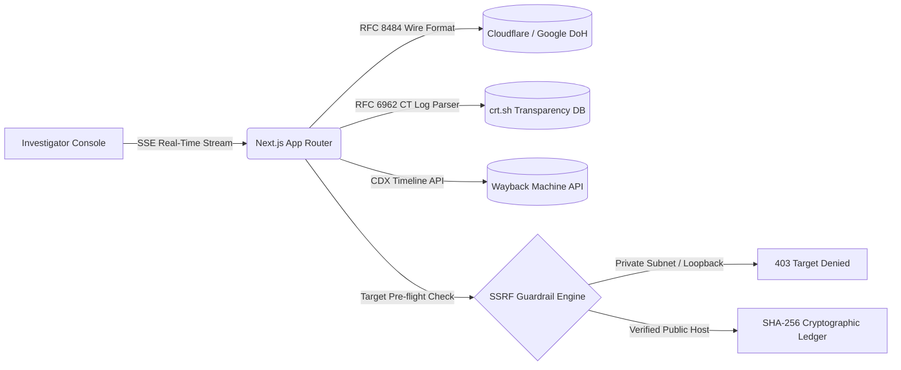

  
   

  

  

    
    
    
    
  

  

    <code>Focus: Defensive OSINT · Network Protocols (RFC 8484 / 6962) · Edge Web Systems · Human-in-the-Loop Agent Guardrails</code>
  

---

## ⚡ Quick Profile & Core Focus

- 🔭 **Primary Focus**: Low-level passive internet reconnaissance, wire-format DNS-over-HTTPS resolvers ([RFC 8484](https://datatracker.ietf.org/doc/html/rfc8484)), and Certificate Transparency log stream parsing ([RFC 6962](https://datatracker.ietf.org/doc/html/rfc6962)).
- 🛡️ **Engineering Rigor**: Test-driven software engineering with **293 verified passing automated tests** in production flagships, maintaining strict SSRF guards and forensic cryptographic ledgers.
- 🌐 **Client & Edge Deployments**: Architecting high-performance commercial frontends — from 28 pre-rendered static route edge SSG catalogs to lightweight 60 FPS 3D WebGL orbital viewports.
- 🤖 **Agentic Systems**: Developing human-in-the-loop review daemons with AST diff heuristic analyzers to prevent runaway autonomous edits.
- 💬 **Ask Me About**: Digital forensics, Linux system troubleshooting, Next.js App Router, Vite 6 code-splitting, and building resilient full-stack architectures.

---

## 🌐 Verified Production Deployments & Systems Matrix

Interactive deployment dashboard indexing active production web platforms, defense tooling, and client architectures:

| Project | Domain / Role | Live Status | Verified Capabilities | Architecture & Access |
| :--- | :--- | :--- | :--- | :--- |
| [**Internet Archaeologist**](https://internet-archaeologist-platform.netlify.app) | Defensive OSINT & Forensics |  |  | [Public Repository ↗](https://github.com/SohanV1/internet-archaeologist-platform) |
| [**Iris Biotech**](https://irisbiotech.co.in) | Floriculture B2B & Cold Chain |  |  | [Verified Client Deployment ↗](https://irisbiotech.co.in) |
| [**3G Floritech**](https://3g-floritech.netlify.app) | 3D Interactive Botanical Showcase |  |  | [Verified Client Showcase ↗](https://3g-floritech.netlify.app) |
| [**AI Builder Notifier**](https://github.com/SohanV1/ai-builder-notifier) | Autonomous Agent Safety & Review |  |  | [Public Repository ↗](https://github.com/SohanV1/ai-builder-notifier) |
| [**JEE Advanced Tracker**](https://github.com/SohanV1/jee-advanced-goal-tracker-) | Academic Velocity & Analytics |  |  | [Public Repository ↗](https://github.com/SohanV1/jee-advanced-goal-tracker-) |
| [**MorphFlow Transitions**](https://github.com/SohanV1/morphflow-transitions) | UI Choreography & Motion Lab |  |  | [Public Repository ↗](https://github.com/SohanV1/morphflow-transitions) |

> **🔒 Client Confidentiality & Architecture Standard**:
> Commercial production codebases ([Iris Biotech](https://irisbiotech.co.in) and [3G Floritech](https://3g-floritech.netlify.app)) strictly isolate all client environment configurations, webhook tokens, and backend deployment keys into private edge secret vaults and `.gitignore` (`.env*`, `*.local`, `.netlify/`). Codebases maintain zero committed credentials or sensitive tokens.

---

## 🏛️ Flagship Engineering Projects

### 🔍 [Internet Archaeologist Platform](https://github.com/SohanV1/internet-archaeologist-platform)
*Enterprise Multi-Agent Defensive OSINT & Temporal Forensics Suite*

- **The Engineering Challenge**: Building a distributed passive reconnaissance system that reconstructs historical internet footprints and detects infrastructure drift without intrusive port scanning or alerting target infrastructure.
- **Key Engineering Achievements**:
  - Wire-format RFC 8484 DNS-over-HTTPS (DoH) resolver and RFC 6962 Certificate Transparency ingestion pipeline.
  - Outbound SSRF defense engine blocking private IP spaces, link-local addresses, and non-HTTP protocols (`file://`, `gopher://`).
  - Cryptographic evidence ledger using SHA-256 hashes to guarantee forensic audit trail immutability.
- **Rigor & Verification**: Tested across 22 Jest test suites with **293 verified passing tests**. Strict adherence to `ETHICAL_OSINT_CHARTER.md`.
- **Stack**: Next.js 16 (App Router), React 19, TypeScript (Strict), Tailwind CSS, D3.js, Jest.
- **Links**: [Live Production Platform ↗](https://internet-archaeologist-platform.netlify.app) · [GitHub Repository ↗](https://github.com/SohanV1/internet-archaeologist-platform)

<b>⚙️ Expand Deep Technical Architecture & Verification Details</b>

 

1. **RFC 8484 DNS-over-HTTPS Engine**: Encodes DNS queries directly into wire format over HTTP/2 and HTTP/3 without relying on local system resolvers, bypassing local DNS cache poisoning.
2. **RFC 6962 Certificate Transparency Parser**: Extracts issued TLS certificates from public append-only logs to uncover unindexed subdomains and historical infrastructure migration paths.
3. **Wayback Machine CDX Timeline Indexer**: Analyzes snapshot frequency, mime-types, and HTTP response codes over time to plot visual change frequency heatmaps.
4. **Target Authorization Gate**: Requires dual attestation before running extended OSINT collection modules, preventing automated misuse.
5. **SSE Telemetry Pipeline**: Uses unbuffered HTTP streaming to deliver instantaneous multi-agent forensic discovery results directly to the browser UI without long-polling overhead.

---

### ⌚ [AI Builder Notifier](https://github.com/SohanV1/ai-builder-notifier)
*Smartwatch & WhatsApp Interactive Gate for Autonomous AI Coding Workflows*

- **The Engineering Challenge**: Autonomous coding agents running in terminal loops can inadvertently introduce unwanted scaffolding or execute destructive edits. This tool provides an asynchronous, human-in-the-loop approval bridge.
- **Technical Architecture**:
  - Real-time WhatsApp multi-device integration via Baileys Web protocol.
  - Change Significance Analyzer (`utils.js`) computing AST/diff line counts and heuristic risk before triggering push alerts.
  - Interactive two-way daemon capturing user `approve` / `reject` commands with automated rollback execution via shell wrappers.
- **Stack**: Node.js, JavaScript (ESM), Baileys, Shell / PowerShell, OpenCode / Antigravity plugins.
- **Links**: [GitHub Repository ↗](https://github.com/SohanV1/ai-builder-notifier) · [License (MIT) ↗](https://github.com/SohanV1/ai-builder-notifier/blob/main/LICENSE)

<b>⚙️ Expand Safety Analyzer & Rollback Protocols</b>

 

- **Diff Heuristic Engine**: Filters out trivial log updates and whitespace changes, escalating only meaningful AST structural changes (schema migrations, file deletions, major logic additions).
- **Automated Rollback Hook**: On `reject` signal via mobile chat, the daemon executes atomic Git stash/checkout rollbacks to restore working trees to verified clean states.

---

### 🌸 [3G Floritech — 3D Interactive Produce & Botanical Showcase](https://3g-floritech.netlify.app)
*Production Client Showcase · [3g-floritech.netlify.app](https://3g-floritech.netlify.app)*

- **The Engineering Challenge**: Delivering an interactive, 360-degree orbital viewport showcase with glassmorphism UI tokens while maintaining low bundle size and silky 60 FPS scroll velocity across mobile and desktop.
- **Key Live Features & Architecture**:
  - **Interactive 3D Botanical Stage**: Real-time 360-degree orbital viewport controls displaying specimen models without the overhead of heavy 3D game engines.
  - **MorphFlow Choreography & Glassmorphism UI**: Dynamic frosted glass HUD cards (`backdrop-filter: blur(14px)`) displaying real-time agronomic data, lipid ratios, and climate cycles.
  - **11-Commodity Agronomic Matrix**: Comprehensive produce catalog (hydroponic Dutch mini-cucumbers, blocky bell peppers, subtropical avocado, high-Brix melons, and seed stock) with interactive specification cards.
  - **Cinematic Launch Video**: Full-screen video showcase integration (`launch-video.html`) with smooth timeline scrub controls.
  - **Zero-Bloat Vite 6 Pipeline**: Rollup code-splitting maintaining ultra-fast paint times and responsive mobile performance.
- **Stack**: Vite 6, Modern ES6+ JavaScript, Responsive Glassmorphism CSS3, Netlify CI/CD.
- **Links**: [Verified Live Showcase ↗](https://3g-floritech.netlify.app)

---

### 🌿 [Iris Biotech — Commercial Floriculture & Cold Chain Export](https://irisbiotech.co.in)
*Production Client Deployment · [irisbiotech.co.in](https://irisbiotech.co.in)*

- **The Engineering Challenge**: Replacing slow B2B directory listings with a high-performance, edge-rendered commercial quotation portal for international floriculture trade, engineered for sub-second international loading and zero aggregator commissions.
- **Key Live Features & Architecture**:
  - **Fast Edge-Rendered SSG**: 28 pre-rendered static route directories generated via a custom post-build pipeline (`scripts/post-build.cjs`) ensuring instant page transitions and full `<noscript>` crawler accessibility.
  - **Dynamic Cut-Flower Catalog**: Detailed cultivar indexing for export Dutch Roses (*Taj Mahal, Sweet Avalanche, Pink Tacazzi, Penny Lane*) and Chrysanthemums (*Baltika White, Zambla*).
  - **Enterprise JSON-LD Entity Disambiguation**: Structured microdata disambiguating Bangalore floriculture operations from European biotech namesakes (`Corporation`, `WholesaleStore`, `hasOfferCatalog`, `FAQPage`).
  - **Integrated RFQ Pipeline**: Direct commercial B2B quotation funnel integrated into enterprise business mail workflows.
- **Stack**: React 18, TypeScript, Vite, Tailwind CSS, Lucide React, Netlify Edge CDN.
- **Links**: [Verified Production Platform ↗](https://irisbiotech.co.in)

<b>⚙️ Expand Edge Rendering & B2B Funnel Specifications</b>

 

- **Post-Build Static Synthesizer**: Iterates over all production routes post-Vite build, injecting pre-rendered HTML DOM trees and meta tags into directory index files to achieve perfect Googlebot indexing and lighthouse performance scores.
- **Cold Storage Logistics Integration**: Displays live Bangalore-to-Airport temperature-controlled dispatch protocols (2°C–4°C cold rooms, refrigerated transit) for overseas procurement officers.

---

### 🎯 [JEE Advanced Goal Tracker](https://github.com/SohanV1/jee-advanced-goal-tracker-)
*Academic Analytics & 6-Stage Chapter Lifecycle Engine*

- **The Engineering Challenge**: Managing high-volume academic syllabus velocity across Physics, Chemistry, and Mathematics with persistent client-side state and cloud resilience.
- **Technical Architecture**:
  - 6-stage chapter workflow engine: Theory → Coaching Module → PYQ Analysis → 3x Scheduled Spaced-Repetition Revisions.
  - Client-side `localStorage` data persistence with portable JSON backup import/export and Firestore security rules synchronization.
- **Stack**: HTML5, CSS3, JavaScript, Firebase Firestore Rules.
- **Links**: [GitHub Repository ↗](https://github.com/SohanV1/jee-advanced-goal-tracker-) · [License (MIT) ↗](https://github.com/SohanV1/jee-advanced-goal-tracker-/blob/main/LICENSE)

---

## 🛠️ Demonstrated Technical Capabilities

### Defensive Reconnaissance & Network Security

### Core Languages & Runtimes

### Frameworks, Libraries & Modern UI

### Infrastructure & Environments

---

## 📊 GitHub Telemetry & Activity

  
  
    
  

---

## 🔬 Current Engineering Workstreams

- **Passive Reconnaissance Hardening**: Integrating BGP Autonomous System Number (ASN) and CIDR mapping into the RFC 6962 CT log analyzer.
- **Deterministic Multi-Agent Guardrails**: Developing AST diff verification hooks to prevent unintended code drift in autonomous development loops.
- **Edge SSG Optimization**: Researching dynamic sub-second edge cache revalidation for high-concurrency agricultural export catalogs.

---

## 📬 Contact & Verified Signals

  
  
  
  

  Built with strict YAGNI principles · Verified with automated test suites · Deployed on edge infrastructure

