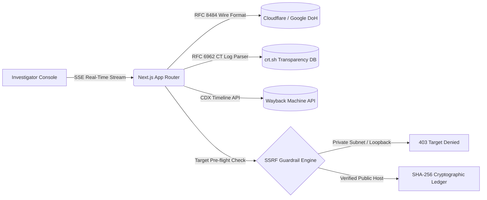

  <!-- Profile Avatar -->
  
    

  <!-- Animated Typing SVG Header (Fira Code, Gradient Cyan-Blue) -->
  

  <!-- Quick Interactive Navigation Anchors -->
  

    
    
    
    
    
  

  

    <code>🛡️ Defensive OSINT · 🌐 RFC 8484 Wire DoH · ⚡ Edge SSG Synthesizers · 🤖 AST Diff Guardrails · 🌸 3D WebGL Showcases</code>
  

---

## ⚡ Engineering Profile & Core Philosophy

I am a **Systems & Web Engineer** focused on defensive cyber reconnaissance, internet infrastructure analysis, and production-grade full-stack web engineering. My work bridges low-level network protocols with high-performance edge web applications.

- 🔭 **Defensive OSINT & Infrastructure Discovery**: Engineering wire-format DNS-over-HTTPS resolvers ([RFC 8484](https://datatracker.ietf.org/doc/html/rfc8484)), append-only Certificate Transparency log stream parsers ([RFC 6962](https://datatracker.ietf.org/doc/html/rfc6962)), and cryptographic SHA-256 evidence ledgers.
- 🧪 **High Rigor & Verification**: Every critical platform is backed by test-driven assertions — including **293 verified passing automated tests** in my flagship forensic platform.
- 🌐 **Production Web Architectures**: Building commercial edge web applications — from 28 pre-rendered static route Edge SSG catalogs with zero-cost crawlers to lightweight 60 FPS 3D WebGL orbital viewports.
- 🤖 **Agentic Safety & Human-in-the-Loop Tooling**: Designing AST diff heuristic gates with mobile chat rollback hooks to prevent unverified code modifications in autonomous AI coding loops.
- 📐 **Engineering Ladder**: Strict adherence to the `/ponytail` ladder — YAGNI first, native platform primitives, standard libraries, zero speculative bloat, and verified minimal diffs.

---

## 🌐 Verified Production Deployments & Public Codebases

Interactive systems matrix indexing verified live production platforms and public architecture repositories:

| System & Project | Domain / Role | Live Production Deployment | Public Source Code | Rigor & Architecture |
| :--- | :--- | :--- | :--- | :--- |
| [**Internet Archaeologist**](https://github.com/SohanV1/internet-archaeologist-platform) | Defensive OSINT & Digital Forensics |  | [SohanV1/internet-archaeologist-platform](https://github.com/SohanV1/internet-archaeologist-platform) |  |
| [**Iris Biotech**](https://irisbiotech.co.in) | Commercial Floriculture & Cold Chain |  | [SohanV1/irisbiotech-showcase](https://github.com/SohanV1/irisbiotech-showcase) |  |
| [**3G Floritech**](https://3g-floritech.netlify.app) | 3D Interactive Botanical Showcase |  | [SohanV1/3g-floritech-showcase](https://github.com/SohanV1/3g-floritech-showcase) |  |
| [**AI Builder Notifier**](https://github.com/SohanV1/ai-builder-notifier) | Human-in-the-Loop Agent Guardrails |  | [SohanV1/ai-builder-notifier](https://github.com/SohanV1/ai-builder-notifier) |  |
| [**JEE Advanced Tracker**](https://github.com/SohanV1/jee-advanced-goal-tracker-) | Academic Velocity & Spaced Repetition |  | [SohanV1/jee-advanced-goal-tracker-](https://github.com/SohanV1/jee-advanced-goal-tracker-) |  |
| [**MorphFlow Transitions**](https://github.com/SohanV1/morphflow-transitions) | UI Choreography & Motion Lab |  | [SohanV1/morphflow-transitions](https://github.com/SohanV1/morphflow-transitions) |  |

> 🔒 **Security & Client Privacy Standard**:
> For commercial client platforms ([Iris Biotech](https://irisbiotech.co.in) and [3G Floritech](https://3g-floritech.netlify.app)), all production environment configurations (`.env*`), `netlify.toml` build configurations, client webhook tokens, and private infrastructure are strictly segregated into private deployment secrets and excluded via `.gitignore`. The public showcase repositories provide pristine, inspectable application architectures with zero leaked credentials.

---

## 🏛️ Flagship Engineering Projects

### 🔍 [Internet Archaeologist Platform](https://github.com/SohanV1/internet-archaeologist-platform)
*Enterprise Multi-Agent Defensive OSINT & Temporal Forensics Suite*

- **The Engineering Problem**: Traditional security reconnaissance tools rely on noisy, intrusive port scans that trigger firewall alarms and lack historical temporal context. Internet Archaeologist performs passive, ethical infrastructure drift analysis using append-only logs and wire-format DNS queries.
- **Key Technical Milestones**:
  - **RFC 8484 DNS-over-HTTPS Resolver**: Encodes raw DNS packets directly into binary wire format over HTTP/2 and HTTP/3, completely bypassing poisoned or cached local network resolvers.
  - **RFC 6962 Certificate Transparency Pipeline**: Ingests public append-only TLS certificate logs to discover unindexed hostnames and identify corporate infrastructure migrations.
  - **Outbound SSRF Mitigation Gate**: Built-in IP validation layer actively resolving targets against private subnets (RFC 1918), link-local spaces, and loopback vectors before dispatching fetches.
  - **SHA-256 Forensic Evidence Ledger**: Computes immutable cryptographic hashes over collected artifacts to establish verifiable chain-of-custody for investigation reports.
- **Test Coverage & Verification**: **293 passing unit & integration tests** across 22 Jest test suites. Full compliance with `ETHICAL_OSINT_CHARTER.md`.
- **Stack**: Next.js 16 (App Router), React 19, TypeScript (Strict), Tailwind CSS, D3.js, Jest.
- **Explore**: [Live Production Platform ↗](https://internet-archaeologist-platform.netlify.app) · [GitHub Repository ↗](https://github.com/SohanV1/internet-archaeologist-platform)

<b>⚙️ Expand Deep Technical Architecture Details</b>

 

1. **Passive Wayback Machine CDX Indexer**: Mines snapshot frequency distributions, mime-types, and HTTP status codes across decades to construct interactive temporal visual heatmaps.
2. **Dual-Attestation Authorization Gate**: Prevents automated reconnaissance abuse by enforcing explicit scope confirmation before initiating high-frequency external log collection.
3. **Unbuffered Server-Sent Events (SSE)**: Streams asynchronous agent discoveries to the browser in real time without polling overhead or socket disconnects.

---

### 🌸 [3G Floritech — 3D Interactive Produce & Botanical Showcase](https://github.com/SohanV1/3g-floritech-showcase)
*High-Performance 3D Viewport & Produce Showcase · [3g-floritech.netlify.app](https://3g-floritech.netlify.app)*

- **The Engineering Problem**: Most 3D web experiences suffer from massive bundle sizes (>15MB), sluggish frame rates on mobile devices, and clunky user interfaces. 3G Floritech provides an ultra-lightweight, 60 FPS interactive showcase for commercial greenhouse agriculture.
- **Key Technical Milestones**:
  - **Interactive 3D Orbital Viewport**: Custom 360-degree orbital controls and specimen animation loops built directly with modern JavaScript and canvas primitives without heavy game engine bloat.
  - **MorphFlow Choreography & Glassmorphism UI**: Frosted glass HUD cards (`backdrop-filter: blur(14px)`, `background: rgba(16, 42, 32, 0.54)`) rendering agronomic profiles, lipid ratios, and diurnal flower dichogamy cycles.
  - **11-Produce Commercial Agronomic Matrix**: Dedicated specification architectures for hydroponic mini-cucumbers, blocky bell peppers, subtropical avocado, high-Brix melons, and seed stock.
  - **Zero-Bloat Vite 6 Pipeline**: Multi-entry Rollup code-splitting delivering sub-second paint times and silky smooth scroll-bound transitions.
- **Stack**: Vite 6, Modern ES6+ JavaScript, Responsive Glassmorphism CSS3 tokens.
- **Explore**: [Verified Live Showcase ↗](https://3g-floritech.netlify.app) · [Public Source Code ↗](https://github.com/SohanV1/3g-floritech-showcase)

---

### 🌿 [Iris Biotech — Commercial Floriculture & Cold Chain Export](https://github.com/SohanV1/irisbiotech-showcase)
*Commercial Floriculture Platform & Edge SSG Architecture · [irisbiotech.co.in](https://irisbiotech.co.in)*

- **The Engineering Problem**: Traditional agricultural B2B trade relies on slow third-party aggregators that charge heavy broker commissions and fail to provide real-time cold-chain provenance for international air-freight buyers.
- **Key Technical Milestones**:
  - **28 Pre-Rendered Edge SSG Routes**: Custom post-build synthesis script (`scripts/post-build.cjs`) generating static directory indices with full `<noscript>` DOM trees, ensuring sub-second international loading and complete Googlebot indexing.
  - **Commercial Cut-Flower Catalog**: Cultivar specifications for export Dutch Roses (*Taj Mahal, Sweet Avalanche, Pink Tacazzi, Penny Lane*) and Chrysanthemums (*Baltika White, Zambla*).
  - **JSON-LD Entity Disambiguation**: Structured enterprise schema (`Corporation`, `WholesaleStore`, `Florist`, `LocalBusiness`, `hasOfferCatalog`, `FAQPage`) disambiguating regional Indian floriculture operations from European biotech namesakes on search engines.
  - **Direct B2B RFQ Funnel**: Custom quotation inquiry pipeline with stem-length selection (60cm–90cm), volume calculations, and cold-chain dispatch specifications.
- **Stack**: React 18, TypeScript, Vite, Tailwind CSS, Lucide React, Edge CDN.
- **Explore**: [Verified Production Platform ↗](https://irisbiotech.co.in) · [Public Source Code ↗](https://github.com/SohanV1/irisbiotech-showcase)

<b>⚙️ Expand Edge SSG Synthesizer & Logistics Architecture</b>

 

- **Automated Directory Synthesizer**: Post-Vite build script traverses all application routes, clones the root DOM shell, and establishes individual static index directories with exact canonical tags to guarantee instant edge distribution.
- **Cold Storage Logistics Integration**: Displays live Bangalore-to-Airport temperature-controlled dispatch protocols (2°C–4°C cold rooms, refrigerated transit) for overseas procurement officers.

---

### ⌚ [AI Builder Notifier](https://github.com/SohanV1/ai-builder-notifier)
*Smartwatch & WhatsApp Interactive Gate for Autonomous AI Coding Loops*

- **The Engineering Problem**: Autonomous AI coding agents running in terminal loops can inadvertently introduce unwanted abstractions, break working patterns, or execute destructive file changes without timely human oversight.
- **Technical Architecture**:
  - Real-time WhatsApp multi-device integration powered by the Baileys Web protocol.
  - Change Significance Analyzer (`utils.js`) evaluating AST/diff line counts and heuristic risk before triggering alerts.
  - Interactive two-way daemon capturing user `approve` / `reject` commands with automated atomic Git stash/checkout rollback hooks.
- **Stack**: Node.js, JavaScript (ESM), Baileys, Shell / PowerShell.
- **Explore**: [GitHub Repository ↗](https://github.com/SohanV1/ai-builder-notifier) · [License (MIT) ↗](https://github.com/SohanV1/ai-builder-notifier/blob/main/LICENSE)

---

### 🎯 [JEE Advanced Goal Tracker](https://github.com/SohanV1/jee-advanced-goal-tracker-)
*Academic Analytics & 6-Stage Chapter Lifecycle Engine*

- **The Engineering Problem**: Tracking complex, multi-year academic syllabus velocity across Physics, Chemistry, and Mathematics requires rigorous spaced repetition without data loss or cloud vendor lock-in.
- **Technical Architecture**:
  - 6-stage chapter mastery engine: Theory → Coaching Module → PYQ Analysis → 3x Scheduled Spaced-Repetition Revisions.
  - Client-side `localStorage` data persistence with portable JSON backup import/export and Firestore security rules synchronization.
- **Stack**: HTML5, CSS3, JavaScript, Firebase Firestore Rules.
- **Explore**: [GitHub Repository ↗](https://github.com/SohanV1/jee-advanced-goal-tracker-) · [License (MIT) ↗](https://github.com/SohanV1/jee-advanced-goal-tracker-/blob/main/LICENSE)

---

## 🛠️ Demonstrated Technical Capabilities

### Defensive Reconnaissance & Network Protocols

### Languages & Runtimes

### Frameworks, UI & Testing

### Infrastructure & Engineering Environments

---

## 📊 GitHub Telemetry & Activity

  
  
    
  

---

## 🔬 Active Engineering Workstreams

- **Passive Reconnaissance Hardening**: Integrating BGP Autonomous System Number (ASN) and IP-prefix aggregation into the RFC 6962 CT log discovery pipeline.
- **Deterministic Multi-Agent Guardrails**: Extending AST diff verification hooks to detect subtle schema shifts and file deletion risks during autonomous AI code generation.
- **Edge SSG Performance**: Benchmarking sub-second stale-while-revalidate edge cache invalidation across distributed global edge nodes for commercial agro-export catalogs.

---

## 📬 Let's Connect

  
  
  
  

  Built with strict YAGNI principles · Verified with automated test suites · Deployed on edge infrastructure

